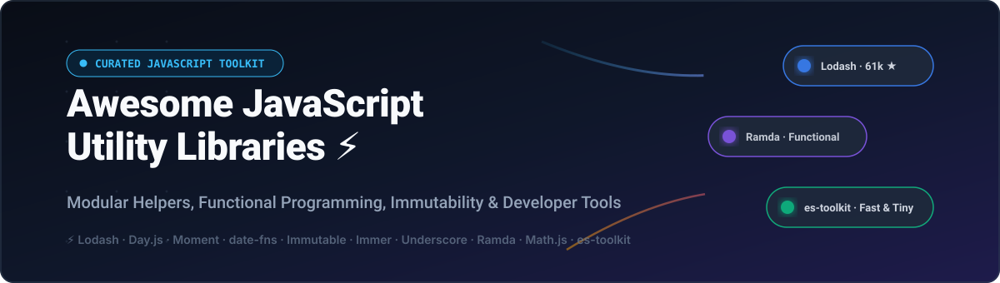

# ⚡ Awesome JavaScript Utility Libraries

  

  
  
  
  
  

## 🚀 The Ultimate JavaScript Utility Libraries Ecosystem

> **A curated collection of modern JavaScript utility libraries, functional programming toolkits, date manipulation helpers, immutable state managers, and enterprise developer SaaS platforms.**

*Last updated: October 2026*

---

## 📖 Overview & SEO Summary

Looking for the best **JavaScript utility libraries** to optimize your web development workflow and boost frontend performance? Whether you need modular helpers like **Lodash** and **es-toolkit**, functional data composition with **Ramda**, lightweight date parsing using **Day.js** and **date-fns**, or state immutability via **Immer** and **Immutable.js**, this comprehensive guide tracks the most reliable, battle-tested solutions in the JS/TS ecosystem.

Key utility patterns covered:
- 🧩 **Array & Object Manipulation**: Modular data transformation, deep cloning, and property traversal.
- 🔄 **Functional Programming (FP)**: Currying, point-free pipelines, and functional composition.
- 🛡️ **Immutable State Management**: Structural sharing and mutation-free state updates for React, Redux, and modern frameworks.
- ⏱️ **Date & Time Calculations**: Zero-dependency timezone math, ISO parsing, and human-friendly formatting.
- 📐 **Mathematics & Computation**: Symbolic calculation, arbitrary-precision arithmetic, and matrix operations.
- 🌐 **Developer Infrastructure & SaaS**: Real-time error monitoring, edge execution, API mocking, and automated vulnerability scanning.

---

## 📑 Table of Contents

- [📊 Sector Overview & Market Dynamics](#-sector-overview--market-dynamics)
- [☁️ SaaS / Hosted Platforms](#️-saas--hosted-platforms)
- [🛠️ Open-Source GitHub Projects](#️-open-source-github-projects)
- [📈 Star History](#-star-history)
- [🤝 How to Contribute](#-how-to-contribute)
- [💖 Support & Sponsorship](#-support--sponsorship)
- [⚠️ Disclaimer](#️-disclaimer)

---

## 📊 Sector Overview & Market Dynamics

The global web developer utilities and edge content delivery network (CDN) sector is estimated at **$27 billion to $37 billion**, projected to surpass $50+ billion over the next decade. The sector features a **dual market structure**: heavily concentrated at the global core edge infrastructure layer dominated by top hyperscalers and network providers, yet highly fragmented across specialized developer productivity, API tooling, search, and security utilities where agile, developer-first platforms compete vigorously.

---

## ☁️ SaaS / Hosted Platforms

| Platform | Category | Scale / Valuation | Pricing (Starting Tier) | Free Tier Limit |
| :--- | :--- | :--- | :--- | :--- |
| **Cloudflare** | Edge Delivery & Serverless Workers | $33.15B - $36.96B Valuation / $1.67B ARR | $5/month (Workers Paid plan) | 100,000 requests/day, 10ms CPU time/request, 1MB max script size |
| **Postman** | API Development & Testing Utility | $5.60B Valuation / $313M ARR | $9/user/month (Solo plan, billed annually) | 1 user, unlimited collection runs & mock server executions, limited AI credits |
| **Snyk** | Developer Security & Utility Scanning | $3.70B - $8.50B Valuation / $325M ARR | $25/developer/month (Team plan, 5 dev minimum) | 200 open-source tests/month, 100 code tests/month, 300 IaC tests/month |
| **Sentry** | Application Performance & Error Utility | $3.00B Valuation / $120M ARR | $26/month (Team plan, billed annually) | 5,000 errors/month, 10,000 spans/month, 50 session replays/month, 1 user |
| **Algolia** | Search & Discovery API Engine | $2.30B Valuation / $150M ARR | $0.50 per 1,000 additional search requests (Grow plan, $0 base) | 10,000 search requests/month, 50,000 records, 1GB index limit |
| **Fastly** | Edge Cloud & Compute Utility | $1.32B - $1.50B Valuation / $544M ARR | $50/month (Developer/Production starter) | 100,000 requests/month, prototyping testing allowance |
| **Wolfram Alpha** | Computational & Math API Engine | $100M parent valuation / $14.2M ARR | $50/month (Developer API tier) | 2,000 non-commercial API calls/month (non-commercial developer trial/hobbyist tier) |
| **BunnyCDN (bunny.net)** | Edge Caching & Content Delivery | Bootstrapped Indie / ~$20M ARR | $1.00/month minimum account spend ($0.01/GB standard edge bandwidth) | 14-day free trial with up to 1 TB of traffic / $50 usage credit |
| **APIVerve** | Cloud Math & Developer Utility API | Bootstrapped / <$5M ARR | $9.99/month (Basic plan, ~100k requests) | 200 requests/month forever |

---

## 🛠️ Open-Source GitHub Projects

*Ranked in descending order by GitHub_Stars ⭐. Stars_Badges link directly to each project's stargazers page.*

1. ### **[Lodash](https://github.com/lodash/lodash)** 
   - **Focus**: The universal modular standard for JavaScript/TypeScript data manipulation.
   - **Highlights**: Over 61,000 GitHub_Stars and 129M+ weekly downloads. Provides deep object cloning, throttling, debouncing, collection grouping, and safe property traversal.
   - **Trade-offs**: Importing entire bundles without tree-shaking can add unwanted weight; modern engines' native methods have replaced several basic functions.

2. ### **[Day.js](https://github.com/iamkun/dayjs)** 
   - **Focus**: Minimalist 2KB date and time manipulation utility with Moment-compatible API.
   - **Highlights**: Extremely fast, immutable by default, and supports a rich plugin system for duration, relative time, and timezone calculations.
   - **Trade-offs**: Complex timezone and calendar edge cases require separate plugin configurations.

3. ### **[Moment.js](https://github.com/moment/moment)** 
   - **Focus**: The foundational date-time parsing, formatting, and validation library.
   - **Highlights**: Deeply embedded legacy standard with massive ecosystem compatibility.
   - **Trade-offs**: Now in maintenance mode; mutable data structures and larger bundle weight make Day.js or date-fns preferred for new greenfield projects.

4. ### **[date-fns](https://github.com/date-fns/date-fns)** 
   - **Focus**: Modular, functional date utility belt (the "Lodash of dates").
   - **Highlights**: Pure functions, fully tree-shakeable, TypeScript-native, and operates on native JavaScript Date instances.
   - **Trade-offs**: Function imports can proliferate across files if not centralized.

5. ### **[Immutable.js](https://github.com/immutable-js/immutable-js)** 
   - **Focus**: Persistent, high-performance immutable data collections.
   - **Highlights**: Provides `Map`, `List`, `Set`, and `Record` using structural sharing to eliminate deep copies and maximize reference-equality checks.
   - **Trade-offs**: Requires explicit conversions (`toJS()`) to work with plain JavaScript objects and third-party UI libraries.

6. ### **[Immer](https://github.com/immerjs/immer)** 
   - **Focus**: Create immutable state simply by mutating a draft state proxy.
   - **Highlights**: Powers Redux Toolkit; allows developers to write standard mutating syntax (`draft.user.name = "new"`) while safely outputting a completely frozen, structurally shared next state.
   - **Trade-offs**: Small runtime proxy overhead compared to manual structural copying.

7. ### **[Underscore.js](https://github.com/jashkenas/underscore)** 
   - **Focus**: The pioneer utility belt for functional helpers in JavaScript.
   - **Highlights**: Created by Jeremy Ashkenas; stabilized the functional programming vocabulary for web applications for over a decade.
   - **Trade-offs**: Mostly superseded by Lodash and native ECMAScript syntax.

8. ### **[Modernizr](https://github.com/Modernizr/Modernizr)** 
   - **Focus**: Browser feature detection standard for HTML5, CSS3, and ES APIs.
   - **Highlights**: Enables graceful degradation and progressive enhancement through custom-tailored detection builds.
   - **Trade-offs**: Narrower utility as modern evergreen browsers achieve strong web-standards alignment.

9. ### **[Ramda](https://github.com/ramda/ramda)** 
   - **Focus**: Practical functional programming designed specifically for composition pipelines.
   - **Highlights**: Auto-curried functions, data-last argument conventions, and zero mutation guarantees.
   - **Trade-offs**: Inverse parameter order relative to standard JS methods requires an intentional learning curve.

10. ### **[validator.js](https://github.com/validatorjs/validator.js)** 
    - **Focus**: Robust string validation, sanitization, and format verification.
    - **Highlights**: Exhaustive checks for emails, UUIDs, IP addresses, credit cards, dates, and XSS sanitization.
    - **Trade-offs**: String-specific focus; complex schema validation typically pairs with Zod or Yup.

11. ### **[Chalk](https://github.com/chalk/chalk)** 
    - **Focus**: Terminal string styling, ANSI coloring, and CLI formatting utility.
    - **Highlights**: High performance, clean chainable API, automatically detects terminal color support (Truecolor, 256 colors).
    - **Trade-offs**: Targeted primarily at Node.js and CLI runtimes.

12. ### **[Math.js](https://github.com/josdejong/mathjs)** 
    - **Focus**: Advanced mathematical computing, symbolic parser, and unit system.
    - **Highlights**: Comprehensive matrix operations, complex numbers, arbitrary-precision decimals, and algebraic expression evaluation.
    - **Trade-offs**: Larger bundle footprint; suited for scientific or data-intensive applications rather than basic arithmetic.

13. ### **[es-toolkit](https://github.com/toss/es-toolkit)** 
    - **Focus**: State-of-the-art modern JavaScript utility library (2-3x faster, up to 97% smaller than Lodash).
    - **Highlights**: Created by Toss; built from scratch with TypeScript, fully tree-shakeable, and includes a built-in Lodash migration compatibility layer.
    - **Trade-offs**: Newer library in the ecosystem, rapidly growing adoption.

14. ### **[Just](https://github.com/angus-c/just)** 
    - **Focus**: Zero-dependency, single-function modular packages (`just-clone`, `just-safe-get`, `just-debounce`).
    - **Highlights**: Cherry-pick exactly the individual helpers you need without bundling monolithic suites.
    - **Trade-offs**: Managing multiple npm packages in `package.json` rather than a unified namespace.

15. ### **[Radash](https://github.com/sodiray/radash)** 
    - **Focus**: Modern, typed functional utilities designed for TypeScript developer ergonomics.
    - **Highlights**: Replaces legacy Lodash patterns with clean async utilities (`retry`, `defer`, `parallel`), object mapping, and array tooling.
    - **Trade-offs**: Focused on modern runtime environments and ES2020+.

16. ### **[Sugar.js](https://github.com/andrewplummer/Sugar)** 
    - **Focus**: Intuitive native prototype helper extensions for Arrays, Objects, and Dates.
    - **Highlights**: Fluent, chainable syntax allowing direct method invocation on primitives.
    - **Trade-offs**: Native prototype mutation can conflict with other third-party dependencies in large shared codebases.

17. ### **[p-limit](https://github.com/sindresorhus/p-limit)** 
    - **Focus**: Async and Promise concurrency throttling utility.
    - **Highlights**: Crucial utility for throttling HTTP requests, database transactions, and background tasks to prevent rate-limiting and resource exhaustion.
    - **Trade-offs**: Hyper-focused utility for promise concurrency.

18. ### **[Memoizee](https://github.com/medikoo/memoizee)** 
    - **Focus**: Complete, robust memoization utility for JavaScript functions.
    - **Highlights**: Supports async functions, LRU caching, TTL expiration, custom serializers, and multi-argument caching.
    - **Trade-offs**: Requires memory management tuning for applications with massive key cardinality.

19. ### **[Mout](https://github.com/mout/mout)** 
    - **Focus**: Modular JavaScript utilities adhering to CommonJS and AMD standards.
    - **Highlights**: Early pioneer of modular utility imports without prototype pollution.
    - **Trade-offs**: Stalled maintenance status; recommended only for legacy maintenance.

20. ### **[micro-dash](https://github.com/simontonsoftware/s-libs)** 
    - **Focus**: Extreme bundle-size-focused Lodash alternative (part of `@s-libs`).
    - **Highlights**: Drops bundle footprints by up to 95% while keeping standard Lodash function signatures.
    - **Trade-offs**: Assumes standard objects and primitives without edge-case coercion.

---

## 📈 Star History

---

## 🤝 How to Contribute

Contributions are warmly welcomed! Help make this ecosystem guide even better:

1. 🍴 **Fork the repository**.
2. 🌿 **Create a descriptive feature branch** (`git checkout -b feature/add-new-utility`).
3. 📝 **Add or update entries** following existing formatting guidelines (include Stars_Badges, official links, strengths, and trade-offs).
4. 🚀 **Submit a Pull Request** with a brief summary of the project and why developers will benefit from it.

---

## 💖 Support & Sponsorship

If you find this curated collection useful, please consider:
- ⭐ **Starring this repository** on GitHub to show your appreciation!
- 🍴 **Forking and sharing** it with your developer network and teammates.
- ☕ **Buying a coffee or sponsoring the project** via the [GitHub Sponsors Dashboard](https://github.com/sponsors/ishandutta2007). Your support helps maintain, update, and expand this resource!

---

## ⚠️ Disclaimer

- This is a **community-curated** list for informational and comparative purposes — not an endorsement.
- **Evaluate bundle overhead**: Modern JavaScript (ES2024+) has absorbed many traditional utility helpers natively (`structuredClone()`, `Array.prototype.flat()`, `Object.groupBy()`). Always test bundle impact with tools like Bundlephobia before adding third-party dependencies.
- **Prototype modification**: Libraries that extend native prototypes (like Sugar.js) should be used with caution in shared or multi-team enterprise environments.

---

**Made with ❤️ for JavaScript developers, open-source maintainers, and web architects.**
